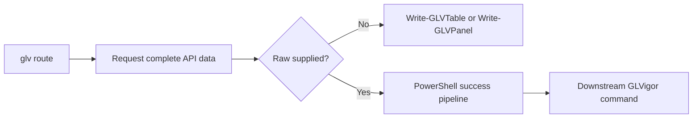

# Pipeline output and `-Raw`

GLVigor separates operator-oriented terminal rendering from full API objects intended for PowerShell pipeline composition.

## Output modes

The `glv` router requests complete data from its underlying search and request commands. It then chooses one of two output paths:



| Mode | Invocation | Success-stream result | Intended use |
| --- | --- | --- | --- |
| Rendered | `glv repo list` | No API object from the renderer | Interactive terminal use |
| Raw | `glv repo list -Raw` | Complete API objects | Filtering, export, and command pipelines |
| Direct filtered | `Search-GitLab -Type issues` | Selected properties | Inspection and lightweight scripts |
| Direct raw | `Search-GitLab -Type issues -Raw` | Complete API objects | Downstream commands requiring IDs or metadata |

## Pipe issue search results

Issue mutation commands need the project ID and issue IID. A raw GitLab issue contains both `project_id` and `iid`.

```powershell
# PowerShell 7.4
glv search 'old issue title' -Type issues -Raw |
    glv task update -Title 'Updated issue title'
```

The direct-cmdlet equivalent is:

```powershell
# PowerShell 7.4
Search-GitLab -Title 'old issue title' -Type issues -Raw |
    Update-Issue -Title 'Updated issue title'
```

## Inspect before mutation

Inspect identifiers before piping multiple objects into an update or delete command.

```powershell
# PowerShell 7.4
$issues = @(glv search 'deployment' -Type issues -Raw)
$issues | Select-Object project_id, iid, title, state

$target = $issues | Where-Object iid -eq 42
$target | glv task update -state_event close
```

<div class="callout warn">
  <div class="callout-bar">Multiple objects</div>
  <div class="callout-body"><p>PowerShell invokes the downstream <code>process</code> block once per input object. Confirm the filtered result count before running mutation or deletion commands.</p></div>
</div>

## Stream behavior

TUI and status messages are written separately from returned data in the router’s raw path. PowerShell consumers should capture the success stream normally:

```powershell
# PowerShell 7.4
$result = @(glv repo list -Raw)
$result.Count
$result | ConvertTo-Json -Depth 8 | Set-Content ./projects.json
```

## Pipeline reference

| Property | Type | Required by | Description |
| --- | --- | --- | --- |
| `id` | Integer | Project-oriented consumers | GitLab global resource identifier. |
| `project_id` | Integer | Issue and merge request consumers | Parent GitLab project identifier. |
| `iid` | Integer | Issue-oriented consumers | Project-scoped issue identifier. |
| `InputObject` | `PSCustomObject` | `Invoke-GLVigor` | Router pipeline input parameter. |
| `Data` | `PSCustomObject` | Supporting public cmdlets | Forwarded object used to resolve IDs. |
| `Raw` | Switch | Search, request, and router output paths | Preserves complete API properties and bypasses router rendering. |
